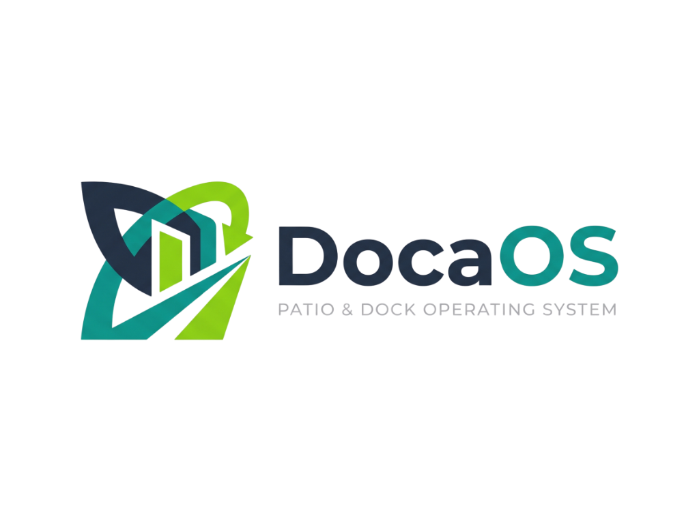

# DocaOS • Patio & Dock Operating System

<p align="center">
  
</p>

<p align="center">
  <strong>Sistema Operacional de Pátios (YMS) & Agendamento Inteligente de Docas</strong><br>
  Eliminação de filas na portaria, credenciamento por Crachá Digital, agenda por slots e blindagem jurídica contra sobreestadias.
</p>

<p align="center">
  <a href="https://docaos.log.br"></a>
  &nbsp;
  <a href="https://github.com/RicardoAlvesReal/DocaOS"></a>
  &nbsp;
  
  &nbsp;
  
</p>

---

## 📌 Visão Geral

O **DocaOS** (`docaos.log.br`) é uma plataforma corporativa completa de **Yard Management System (YMS)** desenvolvida para centros de distribuição, operadores logísticos, portos e indústrias que buscam:

1. **Agilidade Extrema na Portaria**: Check-in óptico em menos de 40 segundos via leitura de QR Code ou placa Mercosul.
2. **Crachá Digital & Pedestres**: Credenciamento instantâneo de **Ajudantes de Carga (Chapas)**, **Motoristas Titulares**, **Prestadores de Serviço Terceirizados** e **Fiscais**.
3. **Visão de Agenda & Matriz de Slots (Gantt)**: Mapeamento em tempo real do pátio e linha do tempo de janelas horárias (06:00 às 22:00) para evitar conflitos operacionais.
4. **Vistoria Preventiva (Lacres & Avarias)**: Auditoria fotográfica e checklist de integridade de lacres de contêineres/baús antes da liberação na cancela.
5. **Blindagem Jurídica sob a Lei 11.442/2007**: Cálculo automático e auditável da tolerância de 5 horas para carga/descarga, gerando laudos probatórios digitais contra cobranças indevidas de estadia.
6. **Comunicação por WhatsApp & PWA sem Instalação**: Chamadas automatizadas para docas via WhatsApp e portal de check-in georreferenciado por cerca virtual GPS.

---

## 🚀 Principais Módulos da Plataforma

### 1. Crachá Digital & Controle de Pedestres (`/crachas`)
* Emissão rápida de credenciais identificando nome, CPF, empresa, placa vinculada e zonas autorizadas.
* **Envio Direto via WhatsApp**: Envie o crachá em segundos para o celular do ajudante/chapa.
* **Layout de Impressão PVC / Bolso**: Padrão visual com tarja institucional, dados cadastrais e QR Code criptografado (`DOCAOS:BADGE:...`).
* **Controle de Presença**: Identificação em tempo real de pessoas e colaboradores em circulação dentro do terminal.

### 2. Gestão & Agenda de Docas em Slots (`/docas`)
* **Modo Tempo Real (Grid Físico)**: Status de cada doca (Livre, Ocupada, Manutenção), veículo em operação e botão de chamada imediata do próximo caminhão da fila via WhatsApp.
* **Modo Agenda & Slots (Gantt Diário)**: Matriz horizontal de janelas horárias configuráveis (slots de 2h) com navegação de calendário dia a dia e status atômicos (`AGENDADO`, `EM_DOCA`, `LIBERADO`).

### 3. Portaria & Cancela Inteligente com Vistoria (`/portaria`)
* Leitor óptico de câmera web, leitor laser USB de guarita ou digitação rápida de placas.
* **Reconhecimento Unificado**: O sistema valida tanto carretas e contêineres quanto crachás digitais de pedestres e chapas.
* **Checklist OEA & ISO 9001**: Auditoria preventiva de número e status do lacre (*Intacto*, *Rompido*, *Divergente da NF*) e registro de avarias físicas na carga.

### 4. Torre de Controle Kanban (`/app`)
* Visão macro dividida em colunas operacionais com drag & drop:
  1. *Agendados (Previstos para o dia)*
  2. *No Pátio / Espera (Check-in realizado na portaria)*
  3. *Em Doca (Carga / Descarga em andamento)*
  4. *Liberados / Saída Concluída*
* Notificações reativas em tempo real via **WebSockets** bidirecionais.

### 5. Cerca Virtual GPS & PWA do Motorista (`/checkin/:token`)
* WebApp interativo sem necessidade de download na loja (Google Play / App Store).
* Validação de geolocalização por satélite (Geofence): o motorista só consegue confirmar chegada se estiver dentro do raio geográfico estabelecido pelo armazém.
* Exibição de QR Code de entrada, instruções de segurança e doca designada.

### 6. Portal de Autoagendamento do Transportador (`/agendar/:slug`)
* Interface pública para transportadoras e embarcadores reservarem janelas horárias com validação técnica de frota (Baú, Sider, Frigorífico, Grade Baixa, Prancha) e controle de temperatura alvo para cadeia fria.

### 7. Relatórios de Auditoria & Cálculo de Estadia (`/relatorios`)
* Indicadores de SLA, Dwell Time médio, índice de pontualidade e volumetria por transportadora.
* Emissão de laudo técnico probatório formatado para impressão e anexação fiscal/jurídica.

---

## 🛠️ Arquitetura Tecnológica

### Backend (API REST & WebSockets)
* **Linguagem**: Python 3.13
* **Framework**: FastAPI (Swagger/OpenAPI em `/docs` e ReDoc em `/redoc`)
* **ORM & Database**: SQLAlchemy 2.0 + PostgreSQL (`psycopg3`)
* **Segurança**: Criptografia de senhas com Passlib (Bcrypt) e autenticação stateless com tokens JWT
* **Integrações B2B**: Webhooks de saída assinados com HMAC-SHA256 (`User-Agent: DocaOS-Webhook/2.0`)
* **Conectores de Telemetria**: Estrutura pronta para recepção de sinais de satélite (Autotrac, Sascar, OnixSat, Cobli)

### Frontend (SPA Reativa)
* **Framework**: Vue 3 (Composition API com `<script setup>`)
* **Build Tool**: Vite 8
* **Gerenciamento de Estado**: Pinia
* **Roteamento**: Vue Router com Navigation Guards
* **Estilização**: TailwindCSS + Design System com tema Dark Mode de alto contraste e tipografia Plus Jakarta Sans & JetBrains Mono
* **Ícones**: Lucide Icons
* **QR Code**: Geração dinâmica com `qrcode` em Base64

---

## 💻 Instalação & Execução Local

### Pré-requisitos
* **Node.js** (v18+)
* **Python** (v3.11+)
* **PostgreSQL** instalado e ativo na porta `5432`

---

### 1. Configuração do Backend

```bash
# Entre na pasta do backend
cd backend

# Crie e ative o ambiente virtual
python -m venv .venv

# Windows (PowerShell):
.\\.venv\\Scripts\\Activate.ps1
# Linux/macOS:
source .venv/bin/activate

# Instale as dependências
pip install -r requirements.txt

# Inicialize o servidor da API (com recarregamento automático)
python -m uvicorn app.main:app --host 127.0.0.1 --port 8000 --reload
```

A API estará acessível em: **`http://127.0.0.1:8000`**  
Documentação interativa Swagger: **`http://127.0.0.1:8000/docs`**

---

### 2. Configuração do Frontend

```bash
# Em outro terminal, acesse a pasta do frontend
cd frontend

# Instale os pacotes Node
npm install

# Inicie o servidor de desenvolvimento Vite
npm run dev
```

A interface web estará acessível em: **`http://localhost:5173`**

---

## 🔑 Credenciais de Acesso (Demonstração)

| Usuário | E-mail | Senha | Função |
| :--- | :--- | :--- | :--- |
| **Operador de Pátio** | `operador@docaos.log.br` | `operador123` | Acesso operacional completo |
| **Super Admin Master** | `admin@raos.com.br` | `admin123` | Gestão de clientes e faturamento |
| **Modo Sandbox** | *Botão 'Testar Sandbox' na tela de login* | *Sem senha* | Navegação com dados simulados |

---

## 📄 Governança & Direitos

* **Plataforma**: DocaOS • Patio & Dock Operating System
* **Domínio Oficial**: [docaos.log.br](https://docaos.log.br)
* **Desenvolvido e Mantido por**: **RAOS Tecnologia LTDA** (CNPJ: `66.914.167/0001-76`)
* **Repositório Oficial**: [https://github.com/RicardoAlvesReal/DocaOS.git](https://github.com/RicardoAlvesReal/DocaOS.git)
